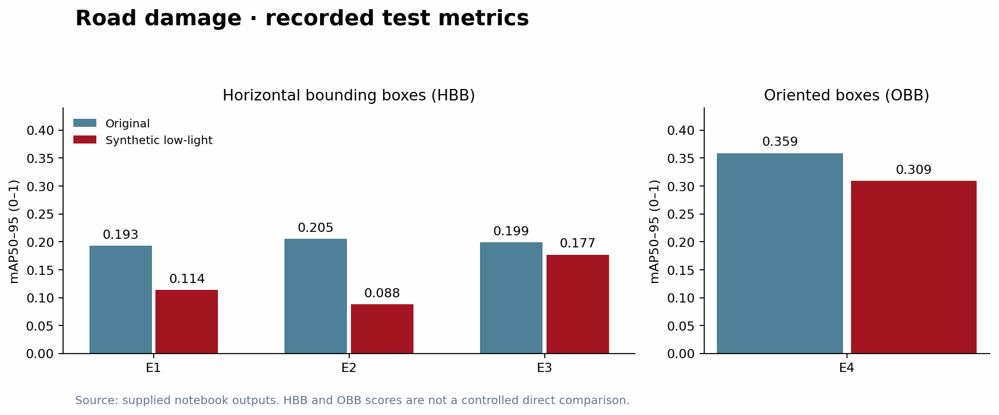

# Road Damage Detection · YOLO11 Experiments

Detect **potholes, cracks, and manholes** using a reproducible preparation pipeline and four pretrained YOLO11 fine-tuning experiments. The project studies bounding-box formulation and robustness to synthetic low-light conditions.

## Research workflow

1. Acquire the original image and annotation dataset through KaggleHub or a local override.
2. Profile labels, remove exact duplicate images by MD5, and clean normalized annotations without modifying the source files.
3. Create a filename-grouped train / validation / test split (seed 42).
4. Generate deterministic synthetic low-light variants and keep corresponding original/low-light images in the same split.
5. Fine-tune horizontal-box (HBB) and oriented-box (OBB) detectors.
6. Evaluate on original and paired synthetic low-light test images; export tables and figures.

The supplied notebook records 2,004 deduplicated images: **1,602 train / 201 validation / 201 test**. Mixed-light experiments use 3,204 training images. Grouping by filename blocks reduces leakage risk but does not prove independence between videos or locations.

## Experiments and recorded results

These rounded metrics come from the supplied notebook's saved output, **not a new training run during repository preparation**. Both test conditions contain 201 corresponding images.

| Experiment | Training setup | Epoch cap | Original mAP50–95 | Synthetic low-light mAP50–95 |
|---|---|---:|---:|---:|
| E1 | YOLO11n · HBB · original | 50 | 0.193 | 0.114 |
| E2 | YOLO11s · HBB · original | 150 | 0.205 | 0.088 |
| E3 | YOLO11s · HBB · original + low-light | 150 | 0.199 | 0.177 |
| E4 | YOLO11s-OBB · original + low-light | 150 | 0.359 | 0.309 |

**Interpretation:** E3 records greater synthetic low-light robustness than E2 under the HBB formulation. E4 uses a different annotation/overlap formulation, so its scores are not a controlled, directly comparable improvement over HBB. E1 versus E2 also changes model size, training duration, and augmentation together.



See `results/historical_results.csv` for precision, recall, and per-class AP50. The notebook's TTA attempt logged that augmentation was unsupported for its selected OBB model and reverted to single-scale inference; do not claim a TTA improvement from that attempt.

## Run locally

Python 3.12 is recommended; saved run logs recorded Python 3.12.14, Ultralytics 8.4.174, and PyTorch 2.11.0+cu128 on an RTX 4050 laptop GPU. This repository pins the recorded Ultralytics version but does not provide a complete historical environment lock.

```bash
python -m venv .venv
# Windows PowerShell: .venv\Scripts\Activate.ps1
# macOS / Linux: source .venv/bin/activate
# Install the PyTorch build appropriate for your machine first.
python -m pip install -r requirements.txt
python -m jupyterlab
```

Use the [official PyTorch installer](https://pytorch.org/get-started/locally/) for your CPU/CUDA environment. Open `notebooks/road_damage_experiments.ipynb`, select the environment's kernel, and run cells in order. Dependencies are already installed by the command above; the optional notebook installation cell is only needed when preparing a separate kernel environment.

The configuration cell selects CUDA, MPS, or CPU. It uses batch size 12 / 8 / 4 respectively, image size 640, and Windows workers 0. Training all four experiments takes substantial compute; set `RUN_EXPERIMENTS` to a subset when needed. `QUICK_TEST=True` is a two-epoch pipeline check, **not a reproduction of the reported results**.

Set `RAW_OVERRIDE` in the configuration cell to a local dataset root if downloading is unavailable. The root must contain `images/`, `labels-YOLO/` (HBB), and `labels/` (four-point polygon annotations). Otherwise KaggleHub downloads the dataset; follow Kaggle's authentication steps if prompted. The notebook writes to repository-local `workspace/` and rebuilds its prepared `workspace/ds/` folder. Keep unrelated files outside that generated folder.

Existing experiment `best.pt` files cause training to be skipped. Use a new output directory for changed data/configuration so old weights are not silently reused. Weights and raw images are excluded from Git; they were not provided as repository deliverables.

## Optional camera prototype

`examples/macos_camera_demo.py` retains the original Thai voice demo, separately from notebook Run All. It requires macOS, MPS, the `say` command with Kanya voice, and the Krungthep font. It has **not** been tested during packaging and is not a Windows-compatible demonstration.

```bash
python -m pip install -r requirements-camera-macos.txt
# Run from the repository root, after producing the E4 checkpoint:
python examples/macos_camera_demo.py
```

`ROAD_DAMAGE_WEIGHTS` overrides the checkpoint path. `ROAD_DAMAGE_CAMERA` accepts a camera number (default `0`) or your own stream URL. The original private network address was removed. Press Q to exit. Alert levels use bounding-box size relative to frame size, not measured distance, and are not a validated driving-safety feature.

## Verification and limitations

```bash
python -m pip install -r requirements-dev.txt
python scripts/check_notebooks.py
```

Packaging verification checks notebook structure and Python syntax without downloading data, retraining, opening a camera, or reproducing historical metrics. Synthetic darkness is not real nighttime validation. The notebook selects a checkpoint for exploratory plots using test scores; that is not validation-only model selection or an untouched final benchmark. See `docs/reproducibility.md`.

## Sources

- [Road Damage Dataset: Potholes, Cracks and Manholes — Lorenzo Arcioni, Kaggle](https://www.kaggle.com/datasets/lorenzoarcioni/road-damage-dataset-potholes-cracks-and-manholes)
- [Ultralytics YOLO11](https://docs.ultralytics.com/models/yolo11/)
- [Ultralytics OBB task documentation](https://docs.ultralytics.com/tasks/obb/)
- [Ultralytics licensing](https://www.ultralytics.com/license)

Dataset images, annotations, and trained weights are not redistributed here. Their upstream terms remain separate from this project. No new license is assigned to third-party components.
